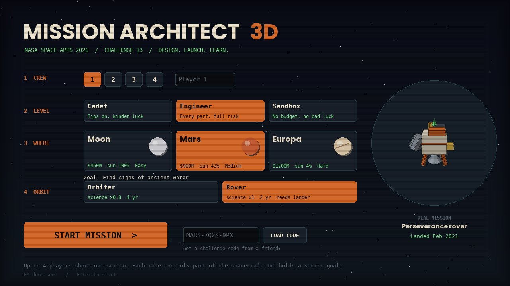
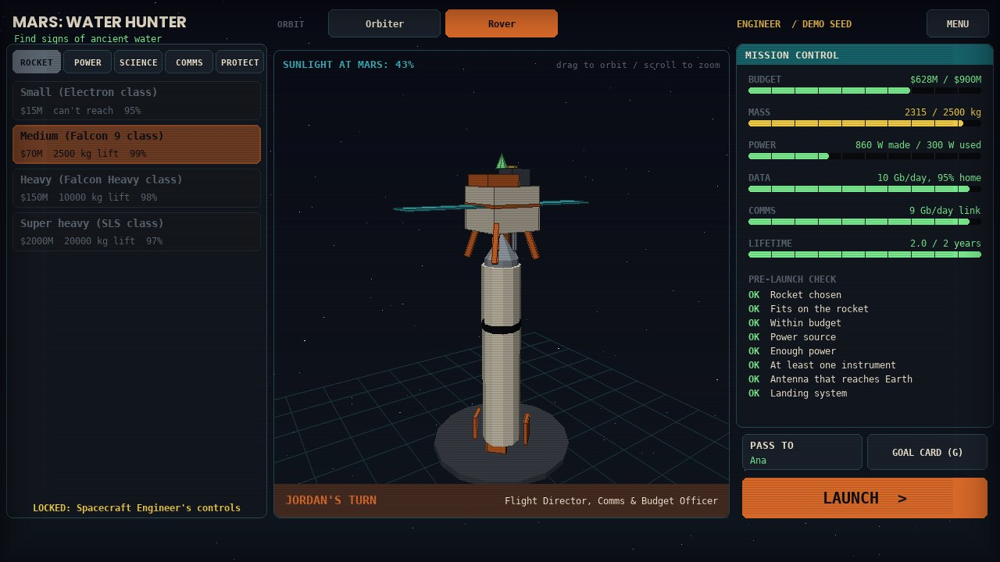
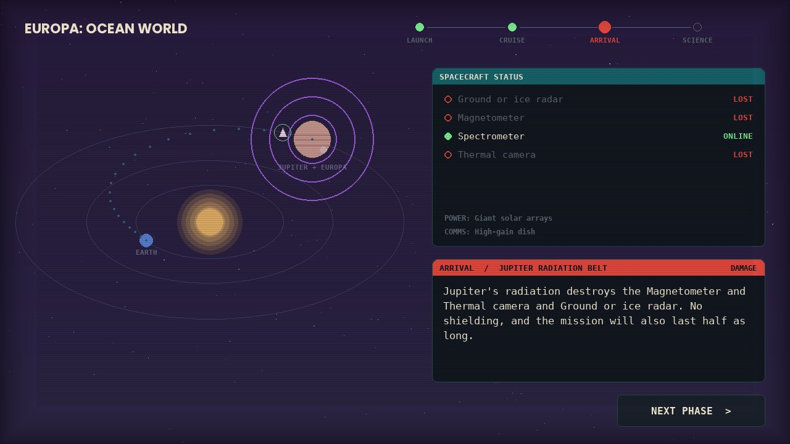
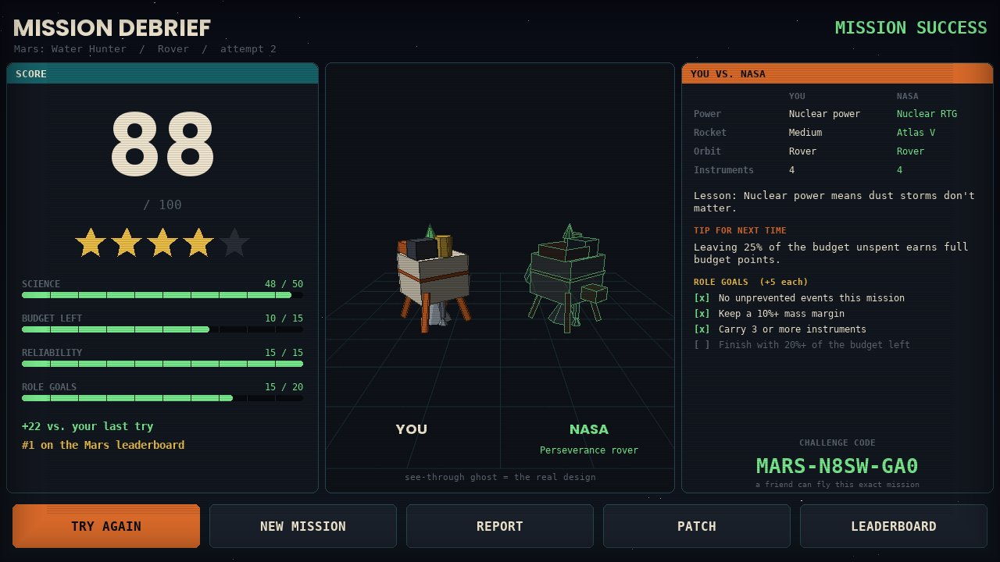

# Mission Architect 3D

**Design a NASA mission. Launch it. Live with the results.**

A 3D browser game for **NASA Space Apps 2026, Challenge 13 (Space Mission Design Game)**. You pick a destination and an orbit, then build a spacecraft part by part on a launch pad. Every part costs money, adds mass and draws power. Launch it, watch the mission play out, then compare your design with the real NASA mission that went there.

**Play now (no install):** **https://howardjordan233-sketch.github.io/mission-architect-3d/**

Written in **100% Python** with pygame-ce. It runs in the browser through [pygbag](https://github.com/pygame-web/pygbag), which compiles Python to WebAssembly. The 3D is drawn by a small renderer written in plain Python, with no 3D library.



## How a round plays (about 5 minutes)

1. **Choose** a crew of 1 to 4 players, a level (Cadet, Engineer or Sandbox), a destination (Moon, Mars or Europa) and an orbit.
2. **Build** in the 3D hangar: rocket, power, up to four instruments, comms and protection. Six live meters react to every click: budget, mass, power, data, comms and lifetime.
3. **Poll the team.** Every role votes Go or No-Go, like real mission control. A No-Go must give a reason and sends the team back to negotiate.
4. **Launch and fly.** Countdown, liftoff and staging, then a map of the solar system where each phase can trigger an event: solar flares, Jupiter's radiation, Mars dust storms, the freezing lunar night, rough landings or a lucky discovery.
5. **Debrief.** You get a score out of 100, stars, a see-through ghost of the real NASA spacecraft beside yours, one tip, a mission report, a mission patch and a challenge code.



## What makes it different

- **The sunlight dimmer.** Solar panels visibly glow less as you go farther from the Sun: 100% at the Moon, 43% at Mars, 4% at Europa. That's real physics: sunlight falls with the square of the distance.
- **The NASA ghost.** Your design sits beside a see-through ghost of Perseverance, Europa Clipper or IM-1 Odysseus.
- **Consequences you can see.** When Jupiter's radiation hits an unshielded probe, its instruments go dark one by one on the status panel, and the message names the part that would have saved them.
- **Team play with secret goals.** Up to four roles share one screen: Flight Director, Spacecraft Engineer, Science Lead, and Comms & Budget Officer. Each role controls part of the spacecraft and holds a secret goal card worth points. Some cards pull against each other: the Engineer wants spare power, while nuclear power gives exactly enough.
- **Challenge codes.** A code like `MARS-7Q2K-9PX` stores the design, the luck and the goal cards. A friend types it in and flies the exact same mission, so the two scores are a fair comparison.
- **A mission patch** drawn from your design, saved as a PNG.




## Challenge coverage

| The challenge asks for | Where it is |
| --- | --- |
| Define objectives and requirements first | Objective and orbit picked before building |
| Spacecraft, instruments, launch vehicle, orbit | 3D hangar plus two orbits per destination |
| Budget, mass, power, data, comms, lifetime | Six live meters |
| Every decision has a consequence | Meters, pre-launch check, events that name the part responsible |
| No single perfect solution | Several designs reach 3 to 4 stars on every mission (run `python balance.py`) |
| Team play for up to 4, with roles | Pass-and-play roles, locked controls, secret goal cards, Go/No-Go poll |
| Simulate many times | "Try again" keeps the design; the debrief shows the change in score |
| Accessible to beginners | Cadet mode, hover help on every part, plain-English report |
| Random events | Flares, radiation, dust storms, lunar night, rough landings, discoveries |
| Interactive spacecraft visualization | Rotatable 3D hangar, launch and flight scenes |
| Mission report and post-mission analysis | Report with three reasons for the outcome, saved as a .txt file |
| Leaderboard, save, share, compare | Top 10 per mission, challenge codes, NASA ghost |
| Sandbox and difficulty levels | Cadet, Engineer and Sandbox |

## Run it

**In the browser:** open the link above. The first load downloads the Python runtime (a few seconds). If the page says *Ready for launch*, click or tap once to start. Mouse, keyboard and touch screens all work.

**On a computer (Python 3.10 or newer):**

```
python -m pip install -r requirements.txt
python main.py
```

**Build the web version yourself:**

```
python -m pygbag --build --archive --ume_block 0 .
```

This makes `build/web/` (upload it anywhere) and `build/web.zip` (for an itch.io HTML project).

**Automatic publishing.** `.github/workflows/pages.yml` runs the tests, builds the web version and publishes it to GitHub Pages on every push to `main`. One-time setup: repo **Settings > Pages > Source: GitHub Actions**.

## Controls

- Click parts to add or remove them; hover over a part to see what it does.
- Drag the 3D view to orbit it, and scroll to zoom.
- Hold **G** or the Goal Card button to peek at your secret goal.
- **Enter** launches when the pre-launch check is green.
- **F9** turns on the demo seed (see below).

## Pitch demo (60 seconds, always the same)

Press **F9** for the demo seed, choose Mars and the Rover orbit, then build a Medium rocket, a Mars landing system, a Mars relay, a spectrometer, drill, radar and camera, and **large solar panels**. A dust storm smothers the panels and the score is **66 (3 stars)**. Press Try Again, swap the power to **Nuclear (RTG)** and launch on the same seed: **93 (5 stars)**. The demo seed also fixes the goal cards, so these numbers are the same every time. The debrief shows that this is exactly what NASA did with Perseverance.

## How it's built

```
main.py            async game loop (pygbag needs await asyncio.sleep(0) every frame)
game/              pure Python rules, no pygame imports
  data.py          catalog: missions, orbits, parts, roles, goal cards
  engine.py        cost, mass, power, data, lifetime, launch check, score
  events.py        the dice: phases and surprise events, seeded
  render3d.py      software 3D: shapes, rotation, perspective, culling, flat shading
  codes.py team.py report.py leaderboard.py storage.py patch.py
scenes/            pygame drawing only: title, hangar, go/no-go, launch, flight, debrief
tests/             pytest: rules, renderer, extras and full click-through playthroughs
tools/snapshots.py renders every screen to PNG without a window
```

**The golden rule:** nothing in `game/` imports pygame, and nothing in `scenes/` holds game rules. A test enforces it. That's why the rules can be tested in a terminal while the same files run in the browser.

**Tests:** `python -m pytest`, 60 tests. They include the 150 W / 200 W power example, a check that every 3D face points outward, a check that a challenge code reproduces the exact score, and 18 full rounds clicked through with real mouse events (every mission, level and team size).

**Browser rules we follow:** an async main loop with nothing after `asyncio.run(main())`; no files written in the browser (the leaderboard uses `localStorage`, and patches and reports download through pygbag); standard library plus pygame-ce only; Python 3.12 syntax, because that's the runtime pygbag ships.

## Real numbers and simplifications

Part values are simplified game numbers based on public NASA and launch-provider figures. Real anchors:

- **Sunlight** at Mars (about 43%) and Jupiter (about 4%) follows the inverse-square law: Mars is about 1.5 times as far from the Sun as Earth, and Jupiter about 5.2 times.
- **Europa Clipper** has the largest solar arrays NASA has built for a planetary mission, a radiation vault for its electronics, and launched on a Falcon Heavy on Oct 14, 2024; it reaches Jupiter in 2030. Its arrays are designed to give at least 700 W through the prime mission, and the game's giant arrays give exactly that. ([JPL spacecraft page](https://jpl.nasa.gov/press-kits/europa-clipper/mission/spacecraft), [JPL quick facts](https://jpl.nasa.gov/press-kits/europa-clipper/quick-facts), [NASA](https://science.nasa.gov/mission/europa-clipper/spacecraft-meet-europa-clipper))
- **Perseverance** runs on an MMRTG nuclear power system and launched on an Atlas V. The real MMRTG makes about 110 W and charges batteries; the game gives the RTG 300 W so it can run a full instrument set without simulating batteries. ([JPL power page](https://www.jpl.nasa.gov/news/press_kits/mars_2020/launch/mission/spacecraft/power/), [INL](https://inl.gov/?p=6482))
- **IM-1 Odysseus** launched on a Falcon 9, landed near the lunar south pole on Feb 22, 2024, then caught a foot and tipped onto its side. ([AmericaSpace](https://www.americaspace.com/2024/02/22/im-1-lands-safely-achieves-first-u-s-soft-lunar-touchdown-since-apollo-17/), [Space.com](https://space.com/intuitive-machines-odysseus-moon-lander-tipped-over))

Rocket classes ("Falcon 9 class" and so on), part prices, science points and event odds are game values tuned for play, not real specifications.

## Credits

- Built for NASA Space Apps 2026 by **<Delta Orbitals>**.
- AI tools used: Claude (Anthropic) wrote and tested the code and balance, and drafted this README.
- Fonts: DejaVu Sans Mono (Bitstream Vera license) and Poppins (SIL Open Font License); license files are in `assets/fonts/`.
- Not affiliated with or endorsed by NASA.
